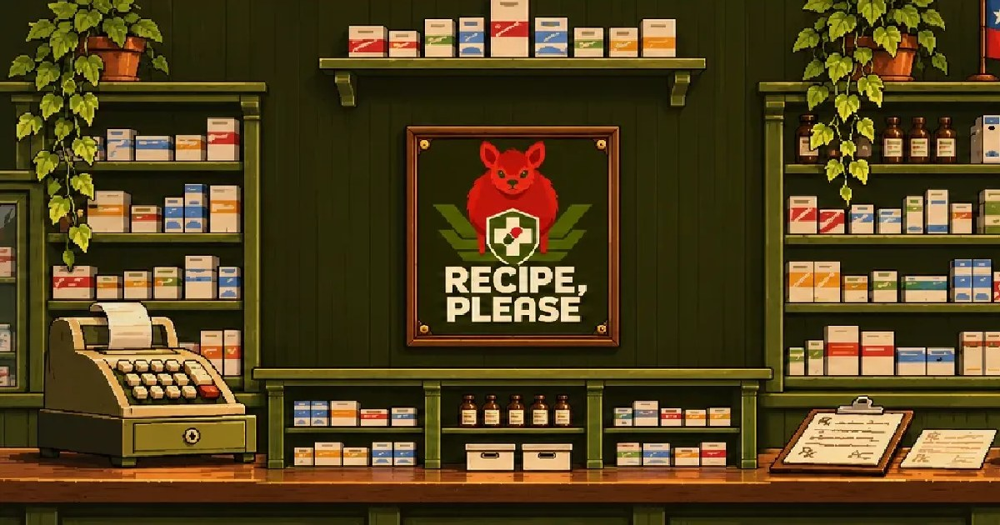

# RECIPE, PLEASE

*Una receta. Una decisión. Una consecuencia.*

Simulador narrativo de una farmacia de barrio en Chile, hecho para jugarse en el navegador. Atiendes el mostrador, revisas recetas, documentos y registros, y decides qué despachar, qué retener y qué denunciar. Cada decisión pesa sobre la caja, la fiscalización y el ánimo del químico farmacéutico y de su familia.

**Jugar:** https://ciclobenzaprinas.github.io/Recipe-please/

## Cómo se juega
- Revisa la receta, el carnet y el historial de cada paciente.
- Despacha, devuelve, retiene o denuncia según lo que encuentres.
- Anota los movimientos en el Libro de control antes de cerrar la jornada.
- Cuida el ánimo del QF y de Charlitos: si cualquiera de los dos llega a 0, la farmacia cierra.
- Hay 7 finales distintos y 34 logros.

Funciona en computador y celular. El progreso se guarda en tu navegador.

## Aviso de contenido
El juego es una ficción con temas que pueden resultar sensibles:
- fraude con recetas y medicamentos controlados,
- presión económica y fiscalización,
- enfermedad y hospitalización de un menor,
- la muerte de una mascota (un pajarito),
- desánimo, agotamiento y abandono del trabajo.

No es una guía clínica ni normativa, y no sirve para tomar decisiones sobre medicamentos reales.

## Créditos
- Diseño, dirección y guion: **Ciclobenzaprina**.
- Programación asistida por Claude (Anthropic).
- Ilustraciones y sprites creados con apoyo de herramientas de IA, bajo la dirección de Ciclobenzaprina.

## Nota legal
Proyecto de ficción sin fines comerciales; marcas e instituciones nombradas son parodias. Cualquier parecido con personas, farmacias o instituciones reales es coincidencia.
